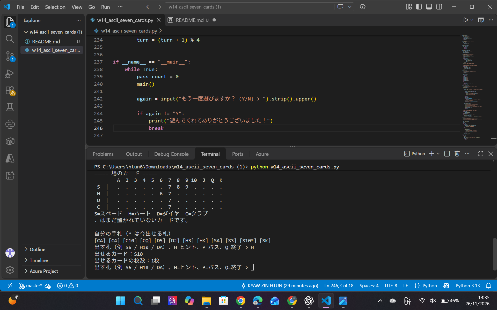

# ASCII 七並べ Plus

## 1. ゲーム概要

Pythonで作成した七並べのカードゲームです。
プレイヤー1人とCPU3人で対戦します。
初心者でも楽しく遊べるように、3つの機能を追加しました。

## 2. 実行方法

Python 3を使用します。
外部ライブラリのインストールは不要です。

```bash
python w14_ascii_seven_cards.py
```

## 3. 遊び方

- 7を中心に、左右へ順番にカードを出します。
- S6やH10などを入力してカードを出します。
- H：出せるカードのヒントを表示します。
- P：パスします。
- Q：現在のゲームを終了します。
- 最初に手札が0枚になったプレイヤーが勝利します。

## 4. 追加した機能

### ① ヒント機能

Hを入力すると、現在出せるカードとその枚数を表示します。
初心者でも出せるカードが分かりやすくなりました。

### ② パス回数制限

プレイヤーのパス回数を3回までに制限しました。
残りのパス回数を表示し、4回目のパスで負けになります。

### ③ リプレイ機能

ゲーム終了後、もう一度遊ぶか選択できます。
Yを入力すると新しいゲームが始まり、
パス回数もリセットされます。
Nを入力するとプログラムが終了します。

## 5. 工夫した点

初心者でも操作しやすいように、
ヒントや残りパス回数を表示するようにしました。
また、プログラムを再起動しなくても、
続けてゲームを楽しめるようにしました。

## 6. 使用技術

- Python 3
- Visual Studio Code
- Git
- GitHub
## 7. 実行画面


